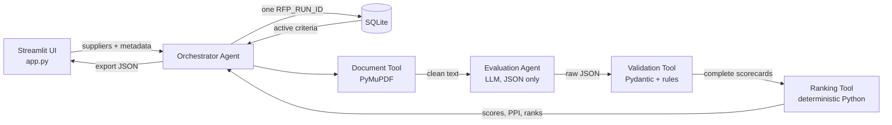

# Agentic RFP Evaluation & Supplier Ranking

An AI-assisted Streamlit app that reads supplier RFP proposals (PDF), scores each one against configurable
criteria with evidence, benchmarks suppliers against their peers, and produces an explainable, deterministic
leaderboard.

**Live app:** `https://<your-app>.streamlit.app`  ← replace after deploying

> **Design principle.** The LLM only *judges proposal content* (score, justification, evidence per criterion).
> Python does everything else: validation, arithmetic, benchmarks, PPI, tie-breaks, ranking and persistence.
> Given the same validated scorecards, the app always produces the same numbers and the same order.

---

## 1. Quick start (local)

```bash
python -m venv .venv && source .venv/bin/activate      # Windows: .venv\Scripts\activate
pip install -r requirements.txt
python -m db.init_db                                   # creates data/rfp.db and seeds 5 criteria
streamlit run app.py
```

In the app: **② Suppliers & Evaluate → Load 5 sample proposals → Evaluate**. The default provider is
**Offline Demo (No API Key)**, so this works immediately with no key and no cost.

To use a real LLM, copy `.streamlit/secrets.toml.example` to `.streamlit/secrets.toml` and add one key
(OpenAI, Groq or Gemini), then pick that provider in the sidebar. You can also paste a key into the
sidebar for the current session only.

Optional regeneration scripts:

```bash
python scripts/make_pdfs.py            # rebuild the synthetic supplier PDFs (set 1 + edge cases)
python scripts/make_pdfs_set2.py       # rebuild sample set 2
python scripts/make_sample_export.py   # rebuild samples/*.json
python -m db.init_db --reset           # restore default criteria
pytest                                 # run the test suite (28 tests)
```

## 2. Deploy on Streamlit Community Cloud

1. Push this folder to a **public GitHub repository** (the `.gitignore` already excludes the database and secrets).
2. Go to <https://share.streamlit.io> → **Create app** → choose the repo, branch `main`, main file `app.py`.
3. **Advanced settings:** Python 3.12. Under **Secrets**, paste the contents of `secrets.toml.example`
  with your real key (optional: Offline Demo works without it).
4. Deploy and put the public URL at the top of this README.

**Note on persistence.** Community Cloud's filesystem is ephemeral: the SQLite file is lost when the app
restarts or sleeps. The app calls `init_db()` on startup, so a fresh container always recreates the tables
and reseeds the criteria. Run history persists while the container is alive. A production version would use
a hosted database (Postgres, Turso, Supabase).

## 3. Architecture



| Component | Responsibility | File |
|---|---|---|
| Orchestrator Agent | Validates inputs, reloads criteria, calls each tool in order, records an agent trace, persists the run | `agents/orchestrator.py` |
| Document Tool | Extracts and cleans PDF text; rejects corrupt, encrypted, empty or image-only PDFs | `tools/pdf_tool.py` |
| Evaluation Agent | Builds a prompt from the **active DB criteria**, calls the LLM, retries once on unusable JSON | `agents/evaluation_agent.py` |
| LLM client | One OpenAI-compatible client for OpenAI / Groq / Gemini, plus a deterministic Mock | `llm/client.py`, `llm/mock_llm.py` |
| Validation Tool | Schema checks, normalisation, evidence verification, warnings | `tools/validation_tool.py` |
| Ranking Tool | Absolute score, benchmarks, gaps, relative %, PPI, stable sort, tie-break explanation | `tools/ranking_tool.py` |
| Persistence | SQLite schema, seed, run storage and history | `db/` |
| Domain models | Pydantic models shared by every layer | `domain/models.py` |

### Data flow (maps to the 10 steps in the brief)

| # | Step | Where |
|---|---|---|
| 1 | Setup: start Streamlit, create/seed DB, load active criteria | `app.py` → `database.init_db()` |
| 2 | Input: upload PDFs, enter name / submission date / experience (1–5) | Tab ② |
| 3 | Batch: validate inputs, generate `RFP-YYYYMMDD-HHMMSS-XXXXXX` | `run_evaluation()` |
| 4 | Evaluate: **reload** criteria from DB, extract text, build prompt, call LLM | Document Tool, Evaluation Agent |
| 5 | Validate: parse JSON, normalise missing / invalid results | Validation Tool |
| 6 | Score: absolute weighted score per supplier | Ranking Tool |
| 7 | Benchmark: best score per criterion, gaps, relative % | Ranking Tool |
| 8 | Rank: PPI, tie-break sort, sequential ranks | Ranking Tool |
| 9 | Persist: `rfp_runs`, `supplier_results`, `criterion_assessments` under one run id | `database.save_run_results()` |
| 10 | Present: leaderboard, scorecards, run details, JSON download | Tabs ③ ④ ⑤ |

## 4. Formulas

Weights are percentages of 100. Every score is first validated into `[0, max_score]`.

| Metric | Formula |
|---|---|
| Absolute weighted score | `Σ (score / max_score) × weight` (range 0–100) |
| Criterion benchmark | highest validated score for that criterion across all suppliers in the run |
| Criterion gap | `score − benchmark` (0 for the leader, otherwise negative) |
| Relative performance % | `score / benchmark × 100`; **if the benchmark is 0, relative % is 0 for everyone** and a warning is recorded |
| Peer Performance Index (PPI) | `Σ (relative % × weight) / Σ weight` |

Values are rounded to 2 decimals **before** sorting, so the order always agrees with the numbers on screen.

**Worked example (sample run, mock LLM).** All five benchmarks are 9.

| Supplier | Tech (30) | Impl (20) | Comm (20) | Sec (20) | Supp (10) | Absolute | PPI |
|---|---|---|---|---|---|---|---|
| NexaWorks | 8 | 9 | 9 | 8 | 9 | 85.00 | 94.44 |
| Apex Systems | 9 | 7 | 8 | 9 | 7 | 82.00 | 91.11 |
| Orbit Digital | 2 | 4 | 5 | 4 | 9 | 41.00 | 45.56 |
| Zenith Consulting | 2 | 4 | 5 | 4 | 9 | 41.00 | 45.56 |
| BrightPath Tech | 3 | 3 | 9 | 1 | 1 | 36.00 | 40.00 |

NexaWorks absolute = 8/10·30 + 9/10·20 + 9/10·20 + 8/10·20 + 9/10·10 = 24 + 18 + 18 + 16 + 9 = **85**.
NexaWorks PPI = (88.89·30 + 100·20 + 100·20 + 88.89·20 + 100·10) / 100 = **94.44**.

## 5. Ranking and tie-breaks

Default (mandatory order from the problem statement):

1. Higher PPI → 2. Earlier submission date → 3. Higher experience rating → 4. Supplier name A–Z (case-insensitive)

Ranks 1, 2, 3… are assigned only after this stable sort. The app writes a plain-English explanation for
every adjacent pair, for example:

> #3 Orbit Digital above #4 Zenith Consulting: PPI tied at 45.56, submission date tied at 2026-10-06;
> decided by experience rating (higher): 5 vs 3.5.

**Design note.** The course build guide suggests ranking by absolute score first. This app follows the brief
(PPI first), because the brief calls that order mandatory. The two can disagree, because PPI is relative to
the peer group:

| | C1 (50%) | C2 (50%) | Absolute | PPI |
|---|---|---|---|---|
| Supplier A | 10 | 2 | **60** | 75 |
| Supplier B | 6 | 4 | 50 | **80** |

The C2 benchmark is only 4, so B's 4/10 counts as 100%. PPI-first ranks B first, even though A has the
higher absolute score. Both numbers are shown on the leaderboard so a reviewer can spot this; PPI is best read
as "distance from best in class", and a human should review the result.
(`tests/test_ranking.py::test_ppi_can_beat_higher_absolute_score` locks this behaviour in.)

## 6. Validation rules

| Problem in LLM output | Action | Counts as normalised? |
|---|---|---|
| Not JSON / wrapped in prose or code fences | Strip fences, extract outer `{…}`; if still invalid, **retry once** with a repair message; if that fails, all criteria = 0 | yes |
| Criterion missing | Added with score 0 | yes |
| Score outside `[0, max_score]` | Clipped to the range | yes |
| Score as text (`"8"`, `"8/10"`) | Parsed; a different denominator (`"4/5"`) is rescaled | only if rescaled |
| Score unusable (`"excellent"`, `null`, NaN, bool) | Set to 0 | yes |
| Unknown or inactive `criterion_id` | Dropped | — |
| Duplicate `criterion_id` | First kept | — |
| Model's `max_score` differs from DB | DB value used | — |
| Evidence quote not found in the document | Score kept, flagged `⚠ unverified` | — |
| Model returns a different supplier name | Entered name used | — |

Every action is recorded as a warning with the supplier and criterion. If more than 30% of a supplier's
criteria were normalised, the scorecard is flagged **low confidence** on the leaderboard.

**Input validation (blocks the run):** active weights must total 100%, every weight above 0, supplier names
required and unique (case-insensitive), experience between 1 and 5, PDF files only, an API key for
real providers.

**Document errors (supplier kept, scored 0, flagged):** corrupt file, password-protected PDF, empty file,
image-only / scanned PDF (fewer than 200 characters of text). Text above 20,000 characters is truncated
with a warning.

## 7. Database

| Table | Purpose |
|---|---|
| `evaluation_criteria` | `criterion_id, name, description, weight, max_score, is_active`. Edited in tab ①; reloaded at the start of every run |
| `rfp_runs` | `rfp_run_id, created_at, status, ranking_mode, llm_provider, llm_model, criteria_snapshot, run_warnings, export_json` |
| `supplier_results` | `rfp_run_id, supplier_name, submission_date, experience_rating, absolute_score, ppi, final_rank, result_json` |
| `criterion_assessments` | one row per supplier × criterion: score, benchmark, gap, relative %, weighted points, evidence, flags |

`criteria_snapshot` stores the exact criteria a run used, so old runs stay traceable after weights change.

## 8. Synthetic test data

All companies, people, clients and figures are fictional. Procurement: *Customer Service Platform
Modernisation* for Meridian Retail Group (`MRG-RFP-2026-014`).

| Supplier | Designed profile | Submitted | Experience |
|---|---|---|---|
| Apex Systems | Strongest technical design and security (ISO 27001, SOC 2 Type II); highest price ($1.24M); 24-week plan | 2026-10-05 | 4.5 |
| BrightPath Tech | Lowest price ($585k) and 12-week timeline; vague security ("best practices", certification only planned); founded 2023 | 2026-10-02 | 2.0 |
| NexaWorks | Balanced; strongest implementation plan (6 milestones, RACI, risk register, pilot, rollback) and support model (24x7x365, SLAs with service credits) | 2026-10-04 | 4.0 |
| Orbit Digital | Strong experience (40+ implementations, 4 references); integration "to be confirmed during discovery"; medium price ($940k) | 2026-10-06 | 5.0 |
| Zenith Consulting | **Tie-break fixture:** deliberately mirrors Orbit so they tie on PPI and date and the experience rule decides | 2026-10-06 | 3.5 |

**Sample set 2** (`sample_rfps/set2/`, button **📂 Load sample set 2**) tests different scenarios:

| Supplier | Scenario tested | Submitted | Experience |
|---|---|---|---|
| Quantum Ledger Solutions | Excellent on every criterion but the highest price ($1.30M): a clear winner | 2026-10-08 | 4.5 |
| Pinnacle Cloud Partners | Best-in-class security (ISO 27701, PCI DSS, quarterly pen tests); business-hours support, founded 2022 | 2026-10-03 | 2.5 |
| SwiftServe Global | Mid-priced and average, with an embedded **prompt-injection** line telling the AI to give it top marks | 2026-10-05 | 3.5 |
| Horizon Integrators | Most detailed integration design, but **no pricing**: "to be submitted separately" | 2026-10-04 | 4.0 |
| Lumen Analytics | Thin, generic proposal with almost no evidence for any criterion | 2026-10-09 | 2.0 |

With a real LLM, check that SwiftServe is **not** scored highly (the system prompt tells the model to treat
the document as data) and that Horizon scores low on Commercial Value.

Edge cases in `sample_rfps/edge_cases/`: `corrupt_file.pdf` (not a PDF) and `scanned_no_text.pdf`
(image-only). To use them, upload them with the file uploader in tab ②.

## 9. Mock LLM (honest description)

`llm/mock_llm.py` is **not** an AI model. It scores each criterion by counting positive and negative signals
(for example "SOC 2 Type II report", "to be confirmed") and quotes the matching sentence as evidence. It
exists so the whole pipeline can be demonstrated and tested reproducibly without an API key. Use a real
provider for the graded demo if you can; real scores will differ from the table above.

The mock also supports **fault injection** for testing (not shown in the UI). Used by the test suite and by
`scripts/make_sample_export.py`, it makes the mock first return non-JSON, then a reply with an out-of-range
score, a text score, a fabricated quote, a missing criterion and an unknown criterion id, exercising every
validation rule. The result is saved as `samples/run_export_validation_case.json`.

## 10. Testing and demo

```bash
pytest     # 28 tests: formulas, PPI, zero benchmark, every tie-break level, order independence,
           # every validation rule, PDF errors, end-to-end runs, persistence, criteria changes
```

**Demo script (about 3 minutes):**

1. Tab ① shows the criteria from SQLite. Change a weight so the total is 105% → **Save** is refused. Restore it.
2. Tab ② → **Load 5 sample proposals** → **Evaluate** → show the progress steps.
3. Tab ③ leaderboard → read the tie-break explanation for Orbit vs Zenith.
4. Tab ④ → open NexaWorks → show benchmark, gap, relative %, evidence (✓ verified).
5. Validation case: upload the two files from `sample_rfps/edge_cases/` → **Evaluate** again. Show the warnings in Run details and the
   broken PDFs ranked last with 0 (⛔ Not evaluated). For LLM-output repairs (clipping, missing criteria,
   retries), open `samples/run_export_validation_case.json` or run `pytest`.
6. Tab ⑤ → **Download JSON**; sidebar → load the previous run from history.

## 11. Assumptions and limitations

- Experience rating is a 1–5 scale entered by the evaluator. Submission date is the date the proposal was received.
- Scores use each criterion's `max_score` from the database (default 10). The LLM's own `max_score` is ignored.
- Unreadable or failed documents stay in the run with 0 so nothing disappears silently.
- PPI is relative to the suppliers in the run: adding or removing a supplier can change it.
- LLM scores and justifications can be wrong; evidence verification only checks that a quote exists, not that
  it supports the score. This is decision support: keep a human in the loop.
- Temperature is 0, but providers do not guarantee identical output on every call. Determinism is guaranteed
  from the validated scorecard onward, which is what the brief requires.
- No OCR: scanned PDFs are rejected with a clear message.

## 12. Screenshots

Add after deploying (save into `docs/screenshots/`):

| Screen | File |
|---|---|
| Criteria | `docs/screenshots/01_criteria.png` |
| Supplier input | `docs/screenshots/02_input.png` |
| Leaderboard | `docs/screenshots/03_leaderboard.png` |
| Scorecard | `docs/screenshots/04_scorecard.png` |
| Run details and warnings | `docs/screenshots/05_run_details.png` |

## 13. Project structure

```
rfp-evaluator/
├── app.py                      Streamlit UI (5 tabs + sidebar)
├── config.py                   all tunable settings
├── requirements.txt
├── agents/
│   ├── orchestrator.py         workflow control, input checks, agent trace
│   └── evaluation_agent.py     prompt + LLM call + retry
├── tools/
│   ├── pdf_tool.py             Document Tool
│   ├── validation_tool.py      Validation Tool
│   └── ranking_tool.py         Ranking Tool (deterministic)
├── llm/
│   ├── client.py               OpenAI / Groq / Gemini client
│   └── mock_llm.py             deterministic mock + fault injection
├── domain/models.py            Pydantic models
├── db/
│   ├── schema.sql
│   ├── database.py
│   └── init_db.py              create + seed script
├── scripts/
│   ├── make_pdfs.py            synthetic supplier PDFs
│   └── make_sample_export.py   sample JSON exports
├── sample_rfps/                5 supplier PDFs + edge_cases/
├── samples/                    run_export.json, run_export_validation_case.json
├── tests/                      pytest suite
└── .streamlit/                 theme + secrets example
```
